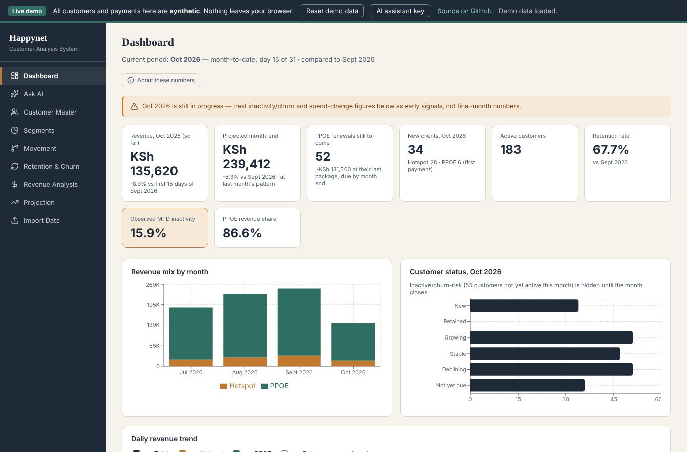

# ISP Customer Analytics

A React app that turns raw M-Pesa payment exports into a customer analysis an internet provider can act on. I built it for **HappyNet Internet Services**, a Kenyan ISP, to replace a manual Excel workflow.

### ▶ [Try the live demo](https://kaliumg432-hub.github.io/isp-customer-analytics/)

The demo runs on **synthetic data**. Every customer, payment and receipt is invented, and nothing leaves your browser.



---

## The problem

The business sells two products, both paid by M-Pesa:
- **Hotspot**: small top-ups of KSh 10–50 for short Wi-Fi bundles
- **Home internet (PPPoE)**: monthly or weekly plans from about KSh 1,500

Every payment lands in one M-Pesa Utility Account statement. Answering basic questions took hours in Excel: who is new, who is slipping away, who should get a call, and what will this month bring in.

## What the app does

Load one or more monthly statement exports (.csv) and it works out the rest.

| Screen | What it shows |
|---|---|
| **Dashboard** | Month-to-date revenue, projected month-end, PPPoE renewals still to come, new clients, active customers and retention rate |
| **Customer Master** | Every customer with behaviour, spend, change, status, risk and suggested action. It can be filtered, sorted and exported to CSV |
| **Segments** | Customers by spend tier: Casual, Developing, Active, High Value, VIP |
| **Movement** | How many customers are New, Growing, Stable, Declining, Not yet due or Inactive, compared with last month |
| **Retention & Churn** | Retained vs lost customers, revenue lost to churn, and a win-back priority list to call first |
| **Revenue Analysis** | Hotspot vs PPPoE revenue by month, the daily trend, and which days of the month customers pay |
| **Projection** | Month-end forecast from the current pace and expected renewals |
| **Ask AI** | Plain-language questions and one-click reports, exportable to PDF |

Each customer also gets **CRM notes**: owner, follow-up date, outcome and notes, all saved between sessions.

## How customers are classified

- **Product:** a payment of KSh 69 or less is a hotspot top-up, and anything above is a PPPoE plan payment. Customers are tagged *Hotspot Only*, *PPOE Only* or *Mixed*.
- **Status:** each period's daily spending rate is compared with the previous month's. Within ±15% counts as *Stable*, above as *Growing*, below as *Declining*. Customers can also be *New*, *Retained*, *Not yet due* or *Inactive/Churn-risk*.
- **Honest mid-month numbers:** while a month is still in progress, missing customers are shown as *observed month-to-date inactivity*, not churn. Someone who hasn't paid yet isn't counted as lost.
- **Billing cycles:** the app infers whether each PPPoE customer is on a daily, weekly, half-monthly or monthly package, so it knows when their next payment is due.
- **Suggested actions:** win-back outreach, retention call, upgrade to a PPPoE plan or a bigger bundle, onboarding offer, or payment reminder.

## How the AI assistant works

The assistant uses the Claude API, but **it never does the arithmetic itself**. Instead of guessing numbers, it asks the app for them in a small structured query language:

```
<query>{"metric":"txns","month":"2026-09","product":"hotspot","groupBy":"hour"}</query>
```

The app runs each query **exactly, on the loaded data**, and returns the results. The assistant then writes its answer from those exact figures. It can send several queries at once, for example to investigate *why* revenue dipped on a given day.

I chose this text-based protocol over native tool calling because tool calling proved unreliable in the environment the app first ran in. It also keeps every number in an answer traceable to the data.

> The public demo needs **your own Anthropic API key** for the assistant. Paste it via "AI assistant key" in the demo bar. It is kept only in the tab's memory and is never saved.

## Repository contents

| Path | What it is |
|---|---|
| `index.html` | The live demo, built into one self-contained file |
| `src/happynet-analytics.jsx` | The app, as built for HappyNet |
| `src/main.jsx` | Demo wrapper: browser storage, demo data loader, API key handling |
| `sample-data/` | Four months of synthetic M-Pesa statements in the real export format |
| `tools/make_sample_data.py` | The script that generates the synthetic data |
| `build.mjs` | Builds `index.html` with esbuild |

## Running it yourself

```bash
npm install
npm run build      # writes index.html
```

Then open `index.html` in a browser. To regenerate the sample data, run `python3 tools/make_sample_data.py`.

## Built with

React 18 · Recharts · PapaParse · Lucide icons · Claude API · esbuild
